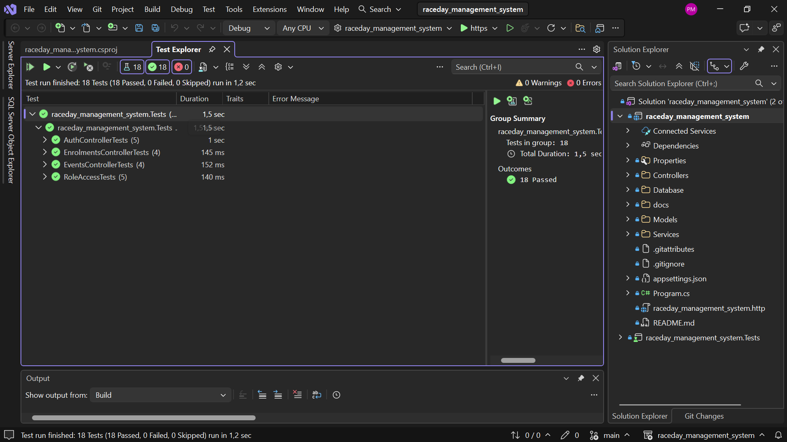
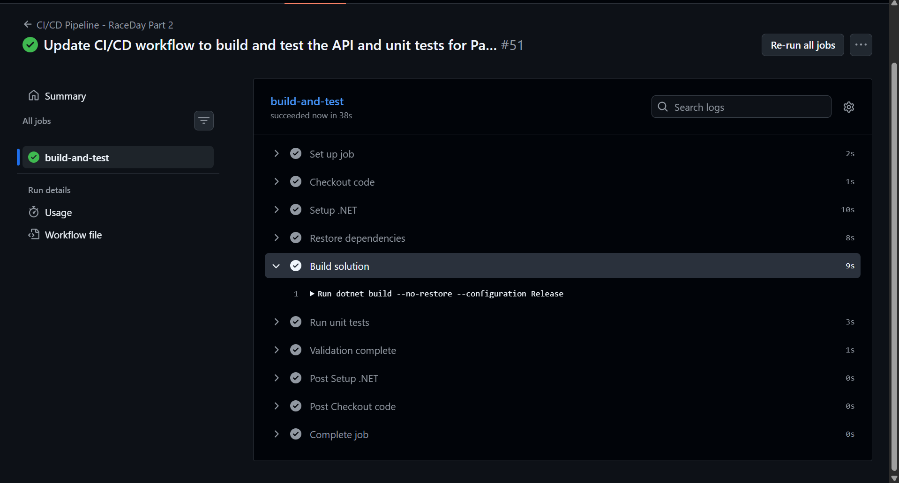

# 🏃 RaceDay - Event Management System

## 📋 Overview

**RaceDay** is a full-stack web-based event management system designed specifically for the South African road running, walking, and cycling community. The platform bridges the gap between Event Organisers and Participants, streamlining the entire event lifecycle from creation to results publishing.

### 🌟 Key Features
- **Event Management**: Create, edit, and manage events with categories
- **Participant Registration**: Browse events and enrol with category selection
- **Results Tracking**: Record and publish race results with finishing positions
- **Role-Based Access**: Separate interfaces for Organisers and Participants
- **Cloud Storage**: Azure Blob Storage integration for event banners and profile pictures (Part 3)
- **Containerized**: Fully Dockerized for easy deployment (Part 3)

---

## 👥 User Roles

### 🎯 Organiser
- Create, edit, and delete events
- Manage event categories (age/distance groups)
- View all event enrolments
- Capture and publish participant results
- Upload event banner images

### 🏃 Participant
- Create account and log in
- Browse upcoming events with filtering
- Enrol in events by selecting a category
- View personal enrolment history
- Track personal race results with finishing positions
- Update profile and upload profile picture

---

# 📘 PART 1 - System Planning and Database

## 📁 Project Structure (Part 1)

```
raceday_management_system/
├── README.md                                    # This file
├── docs/                                        # Documentation folder
│   ├── API ENDPOINT PLAN.pdf                    # Original API endpoint plan
│   ├── API-ENDPOINT-PLAN.pdf                    # Final API endpoint plan
│   ├── ERD.png                                  # Entity Relationship Diagram
│   ├── raceday_db.sql                           # SQL database script with seed data
│   ├── ci-cd-green-build.png                    # Part 2 CI/CD green build screenshot
│   └── test-results.png                         # Part 2 unit test results screenshot
└── .github/
    └── workflows/
        └── ci-cd.yml                            # GitHub Actions CI/CD workflow
```

## 🗄️ Database Schema

### Entities (6 Tables)
1. **Users** - Authentication and user information
2. **Events** - Event/race management
3. **Categories** - Age/distance categories per event
4. **Enrolments** - Participant registrations
5. **Results** - Race results and finishing positions
6. **Event_Images** - Gallery images for events

### ERD Highlights
- ✅ 6 entities with clear relationships
- ✅ Primary and Foreign keys identified
- ✅ Cardinality indicated for all relationships
- ✅ CHECK constraints for data validation
- ✅ Soft delete support (is_active, event_status)
- ✅ Audit fields (created_at, updated_at)

## 🔌 API Endpoint Plan

### Endpoint Summary (38 Total)

| Category | GET | POST | PUT | DELETE | Total |
|----------|-----|------|-----|--------|-------|
| Authentication | 1 | 2 | 0 | 1 | 4 |
| User Profile | 2 | 1 | 1 | 0 | 4 |
| Events | 4 | 2 | 1 | 1 | 8 |
| Categories | 2 | 1 | 1 | 1 | 5 |
| Enrolments | 3 | 1 | 3 | 0 | 7 |
| Results | 4 | 1 | 2 | 1 | 8 |
| Dashboard | 2 | 0 | 0 | 0 | 2 |
| **TOTAL** | **18** | **8** | **8** | **4** | **38** |

### Key Endpoints
- **Authentication**: `/api/authenticator/register`, `/api/authenticator/login`, `/api/authenticator/logout`
- **Events**: `/api/events` (CRUD), `/api/events/{id}/banner` (upload)
- **Categories**: `/api/categories/{id}` (CRUD)
- **Enrolments**: `/api/enrolments/{eventId}`, `/api/enrolments/me`
- **Results**: `/api/results/{eventId}`, `/api/results/me`, `/api/results/{id}/publish`

## 📊 Database Setup Instructions

### Prerequisites
- SQL Server (2019 or later)
- SQL Server Management Studio (SSMS)

### Steps to Create Database

1. **Open SQL Server Management Studio (SSMS)**

2. **Run the SQL Script**
   - Open `docs/raceday_db.sql` in SSMS
   - Click **Execute** (F5) to run the script

3. **Verify Database Creation**
   ```sql
   USE raceday_db;
   SELECT * FROM users;
   SELECT * FROM events;
   SELECT * FROM enrolments;
   ```

4. **Sample Data Included**
   - 2 Organisers (Thabo Mokoena, Sarah Van Der Merwe)
   - 8 Participants with South African names
   - 4 Events (Comrades, Cycle Tour, Soweto, Two Oceans)
   - Categories for each event
   - Enrolments with various statuses
   - Results with finish times and positions

### Seed Data Statistics

| Entity | Count | Description |
|--------|-------|-------------|
| Organisers | 2 | Event creators |
| Participants | 8 | Registered users |
| Events | 4 | Upcoming events |
| Categories | 24 | Categories per event |
| Enrolments | 24 | Participant registrations |
| Results | 11 | Race results |
| Event Images | 8 | Gallery images |

## 🎥 Part 1 Video Presentation

**YouTube Link:** https://youtu.be/krFDeZUgb2M

**Video Content:**
- 📊 ERD Walkthrough
- 📝 API Endpoint Plan
- 🗄️ SQL Script Demonstration in SSMS
- ✅ Validation of all required components

## 📚 Part 1 Deliverables Checklist

| Deliverable | Status | Location |
|-------------|--------|----------|
| Entity Relationship Diagram | ✅ | `/docs/ERD.png` |
| API Endpoint Plan | ✅ | `/docs/API-ENDPOINT-PLAN.pdf` |
| SQL Database Script | ✅ | `/docs/raceday_db.sql` |
| README.md | ✅ | `/README.md` |
| CI/CD Workflow | ✅ | `/.github/workflows/ci-cd.yml` |
| Green Build Screenshot | ✅ | Included in README |
| Video Presentation | ✅ | https://youtu.be/krFDeZUgb2M |

---

# 🚀 PART 2 - RESTful API Development

## 📋 Overview

The RaceDay API is built with **ASP.NET Core 8.0** and uses **ADO.NET** for direct database access. The API implements **session-based authentication**, **role-based access control** (Organiser vs Participant), and exposes **39 RESTful endpoints** across 7 controllers.

### Key Features
- **Session-Based Authentication**: Server-side sessions with 30-minute timeout
- **BCrypt Password Hashing**: Secure password storage using BCrypt.Net-Next
- **Role-Based Access Control**: Enforced at the controller level
- **Ownership Validation**: Organisers can only modify their own resources
- **Swagger Documentation**: Full XML documentation with response codes
- **Unit Tests**: 18 tests passing locally and in CI/CD

---

## 🛠️ Part 2 Technology Stack

| Layer | Technology |
|-------|------------|
| Framework | ASP.NET Core 8.0 Web API |
| Data Access | ADO.NET (`System.Data.SqlClient`) |
| Authentication | Session-based with BCrypt.Net-Next |
| API Docs | Swashbuckle.AspNetCore (Swagger) |
| Testing | xUnit + Moq |
| CI/CD | GitHub Actions |

---

## 📁 Part 2 Project Structure

```
raceday_management_system/
├── Controllers/                          # 7 API controllers
│   ├── authenticator.cs                  # Register, login, logout, current-user
│   ├── users.cs                          # Profile viewing/updating
│   ├── events.cs                         # Event CRUD + nested resources
│   ├── categories.cs                     # Category CRUD
│   ├── enrolments.cs                     # Enrolment management
│   ├── results.cs                        # Result recording and leaderboard
│   └── dashboard.cs                      # Organiser & Participant dashboards
├── Database/                             # ADO.NET data helpers
│   ├── Interfaces/                       # 7 interfaces (for testing with Moq)
│   │   ├── Iauth_connection.cs
│   │   ├── Icategories_connection.cs
│   │   ├── Idashboard_connection.cs
│   │   ├── Ienrolments_connection.cs
│   │   ├── Ievents_connection.cs
│   │   ├── Iresults_connection.cs
│   │   └── Iusers_connection.cs
│   ├── auth_connection.cs                # Auth DB operations
│   ├── users_connection.cs               # User DB operations
│   ├── events_connection.cs              # Event DB operations
│   ├── categories_connection.cs          # Category DB operations
│   ├── enrolments_connection.cs          # Enrolment DB operations
│   ├── results_connection.cs             # Result DB operations
│   └── dashboard_connection.cs           # Dashboard DB operations
├── Models/                               # 6 entity models
│   ├── Categories.cs
│   ├── Enrolments.cs
│   ├── Event_images.cs
│   ├── Events.cs
│   ├── Results.cs
│   └── Users.cs
├── Services/
│   └── password_hasher.cs                # BCrypt password hashing
├── raceday_management_system.Tests/      # Unit test project (xUnit + Moq)
│   ├── AuthControllerTests.cs            # 5 auth tests
│   ├── EnrolmentsControllerTests.cs      # 4 enrolment tests
│   ├── EventsControllerTests.cs          # 4 event tests
│   ├── RoleAccessTests.cs                # 5 role-based access tests
│   ├── FakeSession.cs                    # Fake session helper
│   ├── SessionHelper.cs                  # HTTP context helper
│   └── raceday_management_system.Tests.csproj
└── Program.cs                            # DI registration and pipeline config
```

---

## 🔌 Part 2 API Endpoints (39 Total)

### Authentication (`/api/authenticator`)
| Method | Route | Role |
|--------|-------|------|
| POST | `/register` | Public |
| POST | `/login` | Public |
| POST | `/logout` | Logged in |
| GET | `/current-user` | Logged in |

### User Profile (`/api/users`)
| Method | Route | Role |
|--------|-------|------|
| GET | `/profile` | Any logged in |
| PUT | `/profile` | Any logged in |
| POST | `/profile-picture` | Participant |
| GET | `/{userId}/profile` | Any logged in |

### Events (`/api/events`)
| Method | Route | Role |
|--------|-------|------|
| GET | `/` | Any logged in |
| GET | `/upcoming` | Any logged in |
| GET | `/organiser` | Organiser |
| GET | `/{eventId}` | Any logged in |
| GET | `/{eventId}/categories` | Any logged in |
| GET | `/{eventId}/enrolments` | Organiser (owner) |
| GET | `/{eventId}/results` | Any logged in |
| POST | `/` | Organiser |
| PUT | `/{eventId}` | Organiser (owner) |
| DELETE | `/{eventId}` | Organiser (owner) |
| POST | `/{eventId}/banner` | Organiser (owner) |

### Categories (`/api/categories`)
| Method | Route | Role |
|--------|-------|------|
| GET | `/{categoryId}` | Any logged in |
| POST | `/{eventId}` | Organiser (owner) |
| PUT | `/{categoryId}` | Organiser (owner) |
| DELETE | `/{categoryId}` | Organiser (owner) |

### Enrolments (`/api/enrolments`)
| Method | Route | Role |
|--------|-------|------|
| GET | `/me` | Participant |
| GET | `/me/{eventId}` | Participant |
| POST | `/{eventId}` | Participant |
| PUT | `/{enrolmentId}/cancel` | Participant (owner) |
| PUT | `/{enrolmentId}/status` | Organiser (owner) |
| PUT | `/{enrolmentId}/payment` | Organiser (owner) |
| GET | `/event/{eventId}` | Organiser (owner) |

### Results (`/api/results`)
| Method | Route | Role |
|--------|-------|------|
| GET | `/me` | Participant |
| GET | `/leaderboard/{eventId}` | Any logged in |
| GET | `/{resultId}` | Any logged in |
| POST | `/{eventId}` | Organiser (owner) |
| PUT | `/{resultId}` | Organiser (owner) |
| PUT | `/{resultId}/publish` | Organiser (owner) |
| DELETE | `/{resultId}` | Organiser (owner) |
| GET | `/api/participants/{participantId}/results` | Organiser |

### Dashboard (`/api/dashboard`)
| Method | Route | Role |
|--------|-------|------|
| GET | `/organiser` | Organiser |
| GET | `/participant` | Participant |

See the full endpoint plan in `docs/API-ENDPOINT-PLAN.pdf`.

---

## 🧪 Unit Tests (18 Total)

All tests pass locally and through the GitHub Actions CI/CD workflow.

### Test Project Structure (`raceday_management_system.Tests`)

```
raceday_management_system.Tests/
├── Dependencies/                         # NuGet packages (xUnit, Moq, etc.)
├── AuthControllerTests.cs                # 5 authentication tests
├── EnrolmentsControllerTests.cs          # 4 enrolment tests
├── EventsControllerTests.cs              # 4 event management tests
├── RoleAccessTests.cs                    # 5 role-based access tests
├── FakeSession.cs                        # ISession mock implementation
├── SessionHelper.cs                      # HttpContext factory for tests
└── raceday_management_system.Tests.csproj
```

### Test Coverage

| Test Group | Count | Purpose |
|-----------|-------|---------|
| `AuthControllerTests` | 5 | Register/login success and failure scenarios |
| `EventsControllerTests` | 4 | Event creation, role checks, invalid data |
| `EnrolmentsControllerTests` | 4 | Enrol, duplicate prevention, invalid category |
| `RoleAccessTests` | 5 | Cross-role dashboard & event access |

### Testing Framework

- **xUnit**: Test framework
- **Moq**: Mocking library for interfaces
- **FakeSession**: Custom `ISession` implementation to simulate user login
- **SessionHelper**: Builds `HttpContext` with preset session values

### Test Results



**Local test run:** `Test summary: total: 18, failed: 0, succeeded: 18, skipped: 0`

---

## 🔧 Part 2 CI/CD Pipeline

### GitHub Actions Workflow

Every push to `main` triggers a workflow that:
1. Restores NuGet packages
2. Builds the solution in Release mode
3. Runs all 18 unit tests
4. Reports green build status

### Green Build Screenshot



**Average build time:** ~38 seconds ✅

---

## 🎥 Part 2 Video Presentation

**YouTube Link:** [To be added]

**Video Content:**
- 🎯 API architecture walkthrough
- 🔐 Authentication flow and session management
- 🛠️ All 7 controllers demonstrated
- 🧪 Unit tests running locally and in CI/CD
- ✅ Swagger UI tour

---

## 📚 Part 2 Deliverables Checklist

| Deliverable | Status | Location |
|-------------|--------|----------|
| ASP.NET Core Web API | ✅ | `/Controllers/` |
| ADO.NET Data Access | ✅ | `/Database/` |
| Interfaces for Testing | ✅ | `/Database/Interfaces/` |
| Session-Based Authentication | ✅ | `authenticator.cs` |
| BCrypt Password Hashing | ✅ | `Services/password_hasher.cs` |
| Role-Based Access Control | ✅ | All controllers |
| Swagger Documentation | ✅ | Configured in `Program.cs` |
| Unit Test Project | ✅ | `raceday_management_system.Tests/` |
| 18 Unit Tests | ✅ | 4 test files + 2 helpers |
| CI/CD Workflow | ✅ | `/.github/workflows/ci-cd.yml` |
| Green Build Screenshot | ✅ | `docs/ci-cd-green-build.png` |
| Test Results Screenshot | ✅ | `docs/test-results.png` |
| Video Presentation | ⏳ | To be recorded |

---

## 📊 Commit Statistics

| Part | Minimum Required | Actual Commits | Status |
|------|------------------|----------------|--------|
| Part 1 | 20 | 25+ | ✅ |
| Part 2 | 20 | 20+ | ✅ |

---

## 🛠️ Technology Stack (Full Project)

| Layer | Technology |
|-------|------------|
| Frontend | ASP.NET Core MVC, Bootstrap (Part 3) |
| Backend API | ASP.NET Core Web API (C#) |
| Data Access | ADO.NET (`System.Data.SqlClient`) |
| Database | SQL Server (SSMS) |
| Authentication | Session-based + BCrypt |
| Cloud Storage | Azure Blob Storage (Part 3) |
| Testing | xUnit + Moq |
| CI/CD | GitHub Actions |
| Containerization | Docker (Part 3) |

---

## 📝 Version History

| Version | Date | Changes |
|---------|------|---------|
| 1.0 | 2026-09-03 | Initial Part 1 submission |
| 2.0 | 2026-10-13 | Part 2 - RESTful API with authentication, 39 endpoints, and 18 unit tests |

---

## 🔗 GitHub Repository

**Repository Link:** https://github.com/pande26/raceday_management_system.git

---

## 👨‍💻 Author

**Pandelani**
- GitHub: [@pande26](https://github.com/pande26)

---

## 📄 License

This project is created for academic purposes as part of the Portfolio of Evidence (POE) for the Software Development course.

---

## 🙏 Acknowledgements

- South African road events community (Comrades Marathon, Cape Town Cycle Tour, Soweto Marathon, Two Oceans Marathon)
- Lecturers and mentors providing guidance throughout the project

---

## 🚀 Next Steps

### Part 3 - MVC Web Application
- Build ASP.NET Core MVC frontend
- Consume the Part 2 API
- Integrate Azure Blob Storage
- Containerize with Docker

**✅ Part 1 - System Planning and Database - COMPLETE**

**✅ Part 2 - RESTful API Development - COMPLETE**
